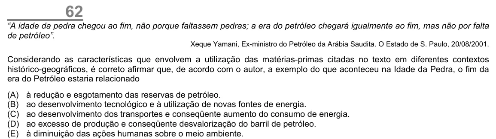

Texto extraído (pode conter ruído)

62  
“A idade da pedra chegou ao fim, não porque faltassem pedras; a era do petróleo chegará igualmente ao fim, mas não por falta  
de petróleo”.  
Xeque Yamani, Ex-ministro do Petróleo da Arábia Saudita. O Estado de S. Paulo, 20/08/2001.  
Considerando as características que envolvem a utilização das matérias-primas citadas no texto em diferentes contextos  
histórico-geográficos, é correto afirmar que, de acordo com o autor, a exemplo do que aconteceu na Idade da Pedra, o fim da  
era do Petróleo estaria relacionado  
(A)  
à redução e esgotamento das reservas de petróleo.  
(B)  
ao desenvolvimento tecnológico e à utilização de novas fontes de energia.  
(C)  
ao desenvolvimento dos transportes e conseqüente aumento do consumo de energia.  
(D)  
ao excesso de produção e conseqüente desvalorização do barril de petróleo.  
(E)  
à diminuição das ações humanas sobre o meio ambiente.

