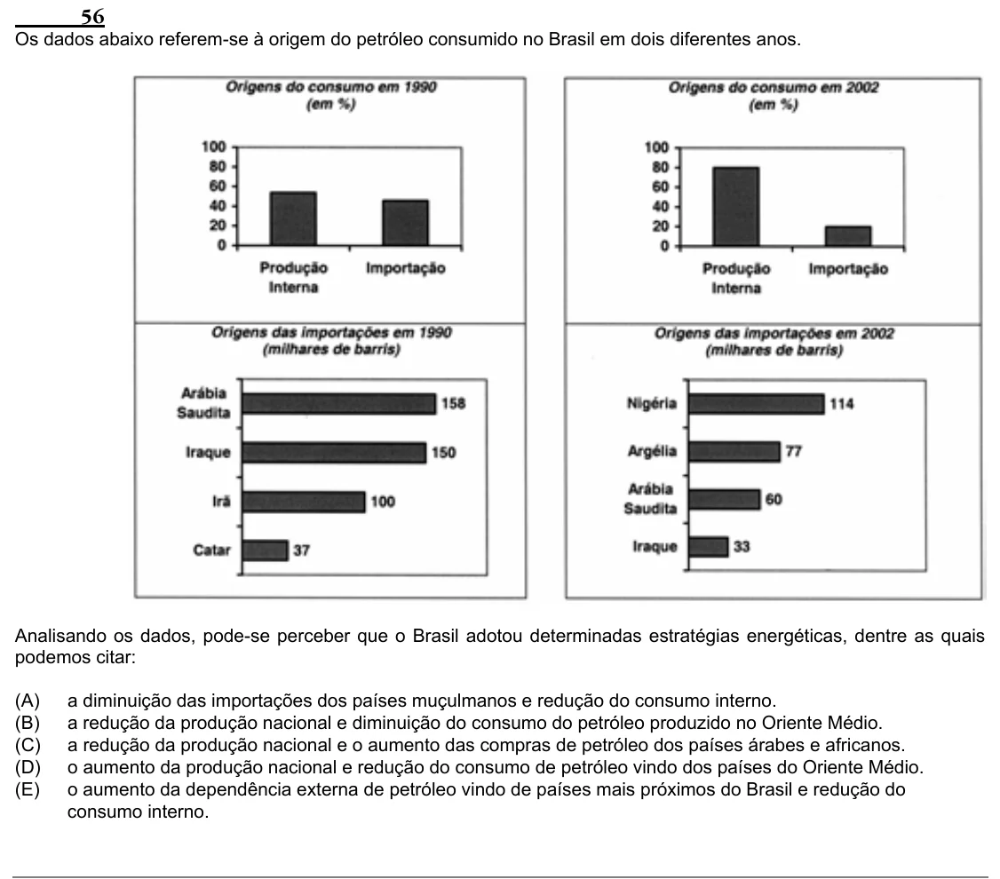

Texto extraído (pode conter ruído)

56  
Os dados abaixo referem-se à origem do petróleo consumido no Brasil em dois diferentes anos.  
Analisando os dados, pode-se perceber que o Brasil adotou determinadas estratégias energéticas, dentre as quais  
podemos citar:  
(A)  
a diminuição das importações dos países muçulmanos e redução do consumo interno.  
(B)  
a redução da produção nacional e diminuição do consumo do petróleo produzido no Oriente Médio.  
(C)  
a redução da produção nacional e o aumento das compras de petróleo dos países árabes e africanos.  
(D)  
o aumento da produção nacional e redução do consumo de petróleo vindo dos países do Oriente Médio.  
(E)  
o aumento da dependência externa de petróleo vindo de países mais próximos do Brasil e redução do  
consumo interno.

