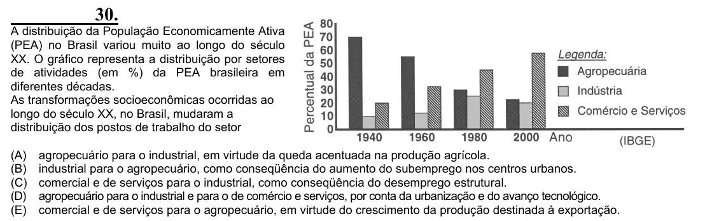

Texto extraído (pode conter ruído)

30.  
A distribuição da População Economicamente Ativa  
(PEA) no Brasil variou muito ao longo do século  
XX. O gráfico representa a distribuição por setores  
de atividades (em %) da PEA brasileira em  
diferentes décadas.  
As transformações socioeconômicas ocorridas ao  
longo do século XX, no Brasil, mudaram a  
distribuição dos postos de trabalho do setor  
(A)  
agropecuário para o industrial, em virtude da queda acentuada na produção agrícola.  
(B)  
industrial para o agropecuário, como conseqüência do aumento do subemprego nos centros urbanos.  
(C)  
comercial e de serviços para o industrial, como conseqüência do desemprego estrutural.  
(D)  
agropecuário para o industrial e para o de comércio e serviços, por conta da urbanização e do avanço tecnológico.  
(E)  
comercial e de serviços para o agropecuário, em virtude do crescimento da produção destinada à exportação.

