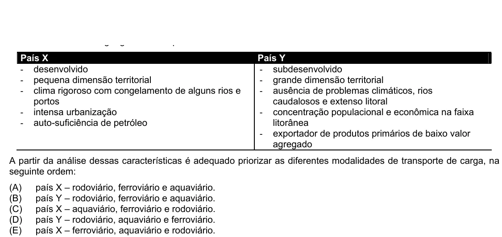

Texto extraído (pode conter ruído)

País X  
País Y  
- desenvolvido  
- subdesenvolvido  
- pequena dimensão territorial  
- grande dimensão territorial  
- clima rigoroso com congelamento de alguns rios e  
- ausência de problemas climáticos, rios  
portos  
caudalosos e extenso litoral  
- intensa urbanização  
- concentração populacional e econômica na faixa  
- auto-suficiência de petróleo  
litorânea  
- exportador de produtos primários de baixo valor  
agregado  
A partir da análise dessas características é adequado priorizar as diferentes modalidades de transporte de carga, na  
seguinte ordem:  
(A)  
país X – rodoviário, ferroviário e aquaviário.  
(B)  
país Y – rodoviário, ferroviário e aquaviário.  
(C)  
país X – aquaviário, ferroviário e rodoviário.  
(D)  
país Y – rodoviário, aquaviário e ferroviário.  
(E)  
país X – ferroviário, aquaviário e rodoviário.

