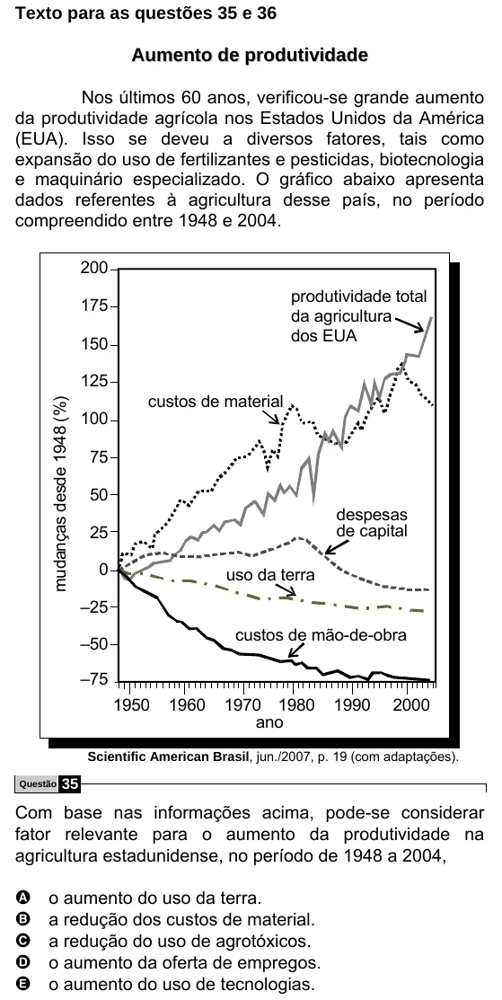

Texto extraído (pode conter ruído)

Texto para as questões 35 e 36  
A u m e n t o d e p r o d u t i v i d a d e  
Nos últimos 60 anos, verificou-se grande aumento  
da produtividade agrícola nos Estados Unidos da América  
(EUA). Isso se deveu a diversos fatores, tais como  
expansão do uso de fertilizantes e pesticidas, biotecnologia  
e maquinário especializado. O gráfico abaixo apresenta  
dados referentes à agricultura desse país, no período  
compreendido entre 1948 e 2004.  
200  
produtividade total  
175  
da agricultura  
dos EUA  
150  
125  
custos de material  
mudanças desde 1948 (%)  
100  
75  
50  
despesas  
de capital  
25  
0  
uso da terra  
–25  
custos de mão-de-obra  
–50  
–75  
1950  
1960  
1970 1980  
1990  
2000  
ano  
Scientific American Brasil, jun./2007, p. 19 (com adaptações).  
35  
Questão  
Com base nas informações acima, pode-se considerar  
fator relevante para o aumento da produtividade na  
agricultura estadunidense, no período de 1948 a 2004,  
A  
o aumento do uso da terra.  
B  
a redução dos custos de material.  
a redução do uso de agrotóxicos.  
C  
o aumento da oferta de empregos.  
D  
E  
o aumento do uso de tecnologias.

