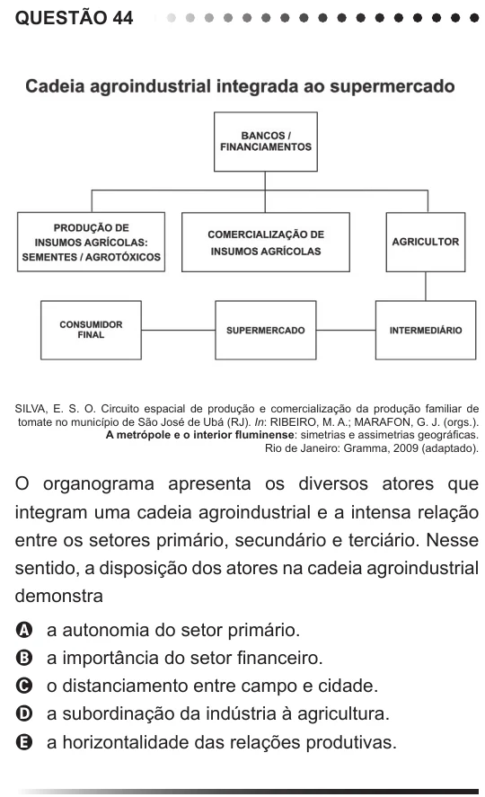

Texto extraído (pode conter ruído)

QUESTÃO 44  
SILVA, E. S. O. Circuito espacial de produção e comercialização da produção familiar de  
tomate no município de São José de Ubá (RJ). In: RIBEIRO, M. A.; MARAFON, G. J. (orgs.).  
A metrópole e o interior fluminense: simetrias e assimetrias geográficas.  
Rio de Janeiro: Gramma, 2009 (adaptado).  
O organograma apresenta os diversos atores que  
integram uma cadeia agroindustrial e a intensa relação  
entre os setores primário, secundário e terciário. Nesse  
sentido, a disposição dos atores na cadeia agroindustrial  
demonstra  
a autonomia do setor primário.  
A  
a importância do setor financeiro.  
B  
o distanciamento entre campo e cidade.  
C  
a subordinação da indústria à agricultura.  
D  
a horizontalidade das relações produtivas.  
E

