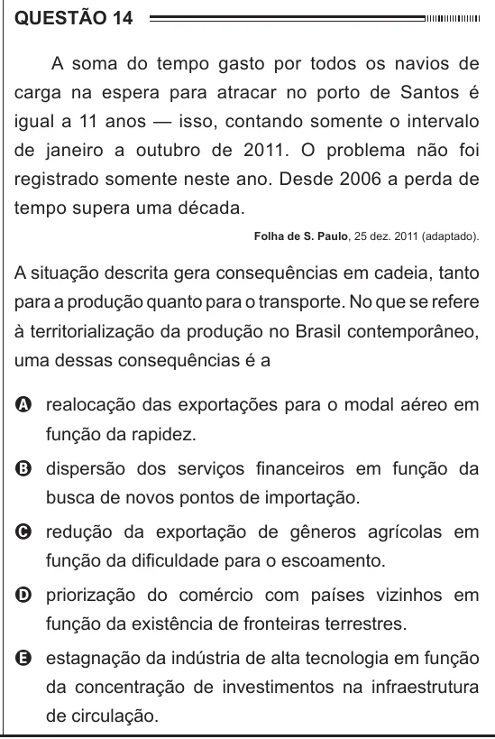

Texto extraído (pode conter ruído)

QUESTÃO 14  
A soma do tempo gasto por todos os navios de  
carga na espera para atracar no porto de Santos é  
igual a 11 anos — isso, contando somente o intervalo  
de janeiro a outubro de 2011. O problema não foi  
registrado somente neste ano. Desde 2006 a perda de  
tempo supera uma década.  
Folha de S. Paulo, 25 dez. 2011 (adaptado).  
A situação descrita gera consequências em cadeia, tanto  
para a produção quanto para o transporte. No que se refere  
à territorialização da produção no Brasil contemporâneo,  
uma dessas consequências é a  
A realocação das exportações para o modal aéreo em  
função da rapidez.  
B dispersão dos serviços financeiros em função da  
busca de novos pontos de importação.  
C redução da exportação de gêneros agrícolas em  
função da dificuldade para o escoamento.  
D priorização do comércio com países vizinhos em  
função da existência de fronteiras terrestres.  
E estagnação da indústria de alta tecnologia em função  
da concentração de investimentos na infraestrutura  
de circulação.

