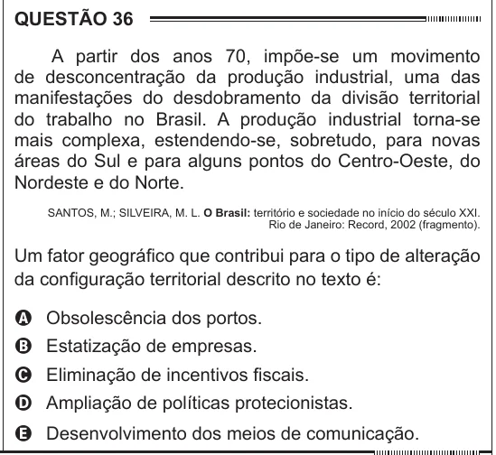

Texto extraído (pode conter ruído)

QUESTÃO 36  
A partir dos anos 70, impõe-se um movimento  
de desconcentração da produção industrial, uma das  
manifestações do desdobramento da divisão territorial  
do trabalho no Brasil. A produção industrial torna-se  
mais complexa, estendendo-se, sobretudo, para novas  
áreas do Sul e para alguns pontos do Centro-Oeste, do  
Nordeste e do Norte.  
SANTOS, M.; SILVEIRA, M. L. O Brasil: território e sociedade no início do século XXI.  
Rio de Janeiro: Record, 2002 (fragmento).  
Um fator geográfico que contribui para o tipo de alteração  
da configuração territorial descrito no texto é:  
A Obsolescência dos portos.  
B Estatização de empresas.  
C Eliminação de incentivos fiscais.  
D Ampliação de políticas protecionistas.  
E Desenvolvimento dos meios de comunicação.

