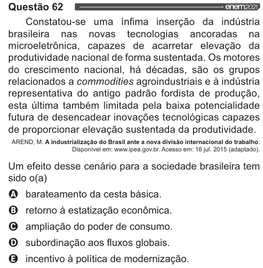

Texto extraído (pode conter ruído)

Questão 62  
Constatou-se uma ínfima inserção da indústria  
brasileira nas novas tecnologias ancoradas na  
microeletrônica, capazes de acarretar elevação da  
produtividade nacional de forma sustentada. Os motores  
do crescimento nacional, há décadas, são os grupos  
relacionados a commodities agroindustriais e à indústria  
representativa do antigo padrão fordista de produção,  
esta última também limitada pela baixa potencialidade  
futura de desencadear inovações tecnológicas capazes  
de proporcionar elevação sustentada da produtividade.  
AREND, M. A industrialização do Brasil ante a nova divisão internacional do trabalho.  
Disponível em: www.ipea.gov.br. Acesso em: 16 jul. 2015 (adaptado).  
Um efeito desse cenário para a sociedade brasileira tem  
sido o(a)  
VOOS  
barateamento da cesta básica.  
retorno à estatização econômica.  
ampliação do poder de consumo.  
subordinação aos fluxos globais.  
incentivo à política de modernização.

