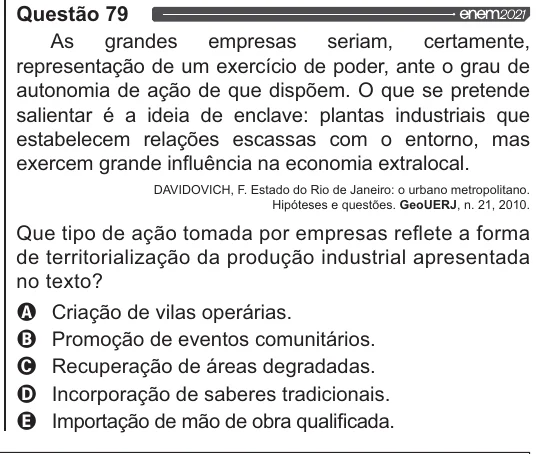

Texto extraído (pode conter ruído)

Questão 79  
As grandes empresas seriam, certamente,  
representação de um exercício de poder, ante o grau de  
autonomia de ação de que dispõem. O que se pretende  
salientar é a ideia de enclave: plantas industriais que  
estabelecem relações escassas com o entorno, mas  
exercem grande influência na economia extralocal.  
DAVIDOVICH, F. Estado do Rio de Janeiro: o urbano metropolitano.  
Hipóteses e questões. GeoUERUJ, n. 21, 2010.  
Que tipo de ação tomada por empresas reflete a forma  
de territorialização da produção industrial apresentada  
no texto?  
Q Criação de vilas operárias.  
O Promoção de eventos comunitários.  
O Recuperação de áreas degradadas.  
O Incorporação de saberes tradicionais.  
& Importação de mão de obra qualificada.

