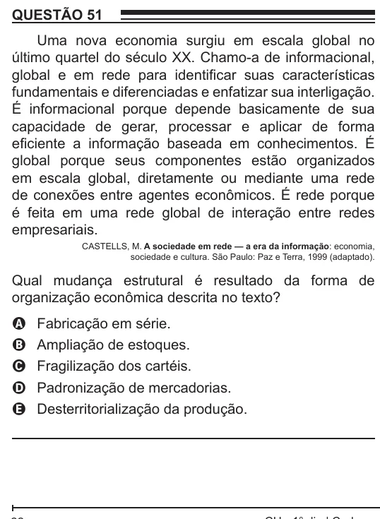

Texto extraído (pode conter ruído)

QUESTÃO 51  
Uma nova economia surgiu em escala global no  
último quartel do século XX. Chamo-a de informacional,  
global e em rede para identificar suas características  
fundamentais e diferenciadas e enfatizar sua interligação.  
É informacional porque depende basicamente de sua  
capacidade de gerar, processar e aplicar de forma  
eficiente a informação baseada em conhecimentos. É  
global porque seus componentes estão organizados  
em escala global, diretamente ou mediante uma rede  
de conexões entre agentes econômicos. É rede porque  
é feita em uma rede global de interação entre redes  
empresariais.  
CASTELLS, M. A sociedade em rede — a era da informação: economia,  
sociedade e cultura. São Paulo: Paz e Terra, 1999 (adaptado).  
Qual mudança estrutural é resultado da forma de  
organização econômica descrita no texto?  
Fabricação em série.  
A  
Ampliação de estoques.  
B  
Fragilização dos cartéis.  
C  
Padronização de mercadorias.  
D  
E  
Desterritorialização da produção.

