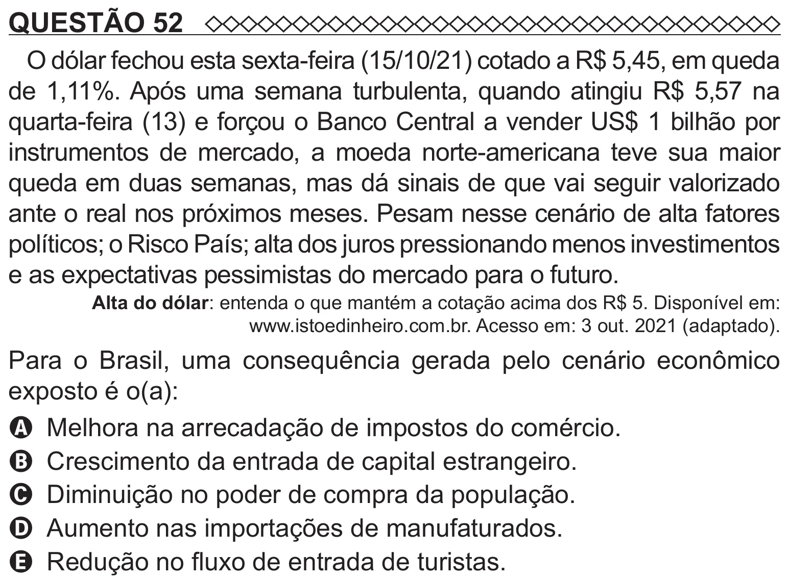

Texto extraído (pode conter ruído)

QUESTÃO 52  
O dólar fechou esta sexta-feira (15/10/21) cotado a R$ 5,45, em queda  
de 1,11%. Após uma semana turbulenta, quando atingiu R$ 5,57 na  
quarta-feira (13) e forçou o Banco Central a vender US$ 1 bilhão por  
instrumentos de mercado, a moeda norte-americana teve sua maior  
queda em duas semanas, mas dá sinais de que vai seguir valorizado  
ante o real nos próximos meses. Pesam nesse cenário de alta fatores  
políticos; o Risco País; alta dos juros pressionando menos investimentos  
e as expectativas pessimistas do mercado para o futuro.  
Alta do dólar: entenda o que mantém a cotação acima dos R$ 5. Disponível em:  
www.istoedinheiro.com.br. Acesso em: 3 out. 2021 (adaptado).  
Para o Brasil, uma consequência gerada pelo cenário econômico  
exposto é o(a):  
A Melhora na arrecadação de impostos do comércio.  
B Crescimento da entrada de capital estrangeiro.  
C Diminuição no poder de compra da população.  
D Aumento nas importações de manufaturados.  
E Redução no fluxo de entrada de turistas.

