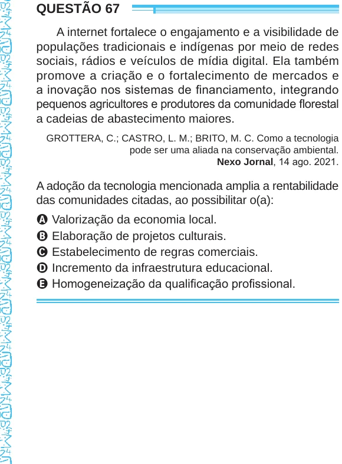

Texto extraído (pode conter ruído)

QUESTÃO 67  
A internet fortalece o engajamento e a visibilidade de  
populações tradicionais e indígenas por meio de redes  
sociais, rádios e veículos de mídia digital. Ela também  
promove a criação e o fortalecimento de mercados e  
a inovação nos sistemas de financiamento, integrando  
pequenos agricultores e produtores da comunidade florestal  
a cadeias de abastecimento maiores.  
GROTTERA, C.; CASTRO, L. M.; BRITO, M. C. Como a tecnologia  
pode ser uma aliada na conservação ambiental.  
Nexo Jornal, 14 ago. 2021.  
A adoção da tecnologia mencionada amplia a rentabilidade  
das comunidades citadas, ao possibilitar o(a):  
A Valorização da economia local.  
B Elaboração de projetos culturais.  
C Estabelecimento de regras comerciais.  
D Incremento da infraestrutura educacional.  
E Homogeneização da qualificação profissional.

