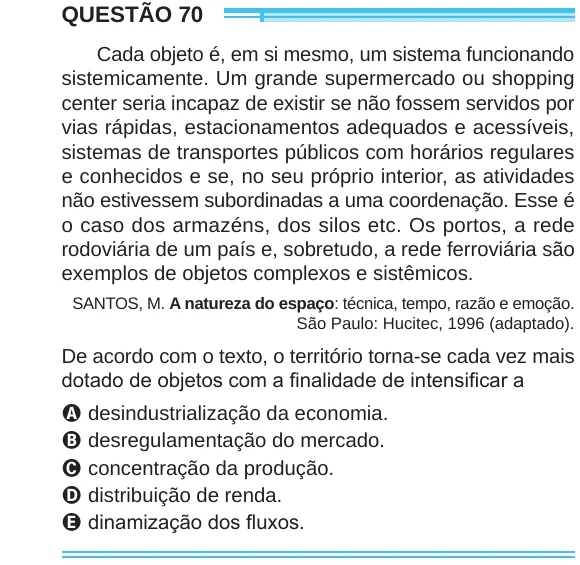

Texto extraído (pode conter ruído)

QUESTÃO 70  
Cada objeto é, em si mesmo, um sistema funcionando  
sistemicamente. Um grande supermercado ou shopping  
center seria incapaz de existir se não fossem servidos por  
vias rápidas, estacionamentos adequados e acessíveis,  
sistemas de transportes públicos com horários regulares  
e conhecidos e se, no seu próprio interior, as atividades  
não estivessem subordinadas a uma coordenação. Esse é  
o caso dos armazéns, dos silos etc. Os portos, a rede  
rodoviária de um país e, sobretudo, a rede ferroviária são  
exemplos de objetos complexos e sistêmicos.  
SANTOS, M. A natureza do espaço: técnica, tempo, razão e emoção.  
São Paulo: Hucitec, 1996 (adaptado).  
De acordo com o texto, o território torna-se cada vez mais  
dotado de objetos com a finalidade de intensificar a  
A desindustrialização da economia.  
B desregulamentação do mercado.  
C concentração da produção.  
D distribuição de renda.  
E dinamização dos fluxos.

