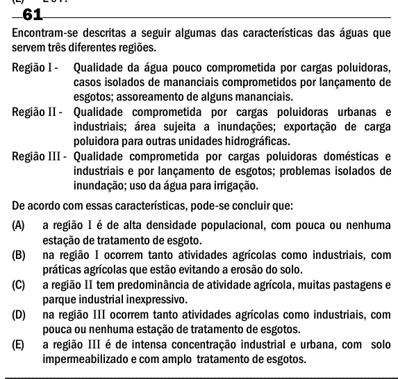

Texto extraído (pode conter ruído)

61  
Encontram-se descritas a seguir algumas das características das águas que  
servem três diferentes regiões.  
Região I -  
Qualidade da água pouco comprometida por cargas poluidoras,  
casos isolados de mananciais comprometidos por lançamento de  
esgotos; assoreamento de alguns mananciais.  
Região II - Qualidade comprometida por cargas poluidoras urbanas e  
industriais; área sujeita a inundações; exportação de carga  
poluidora para outras unidades hidrográficas.  
Região III - Qualidade comprometida por cargas poluidoras domésticas e  
industriais e por lançamento de esgotos; problemas isolados de  
inundação; uso da água para irrigação.  
De acordo com essas características, pode-se concluir que:  
(A)  
a região I é de alta densidade populacional, com pouca ou nenhuma  
estação de tratamento de esgoto.  
(B)  
na região I ocorrem tanto atividades agrícolas como industriais, com  
práticas agrícolas que estão evitando a erosão do solo.  
(C)  
a região II tem predominância de atividade agrícola, muitas pastagens e  
parque industrial inexpressivo.  
(D)  
na região III ocorrem tanto atividades agrícolas como industriais, com  
pouca ou nenhuma estação de tratamento de esgotos.  
(E)  
a região III é de intensa concentração industrial e urbana, com solo  
impermeabilizado e com amplo tratamento de esgotos.

