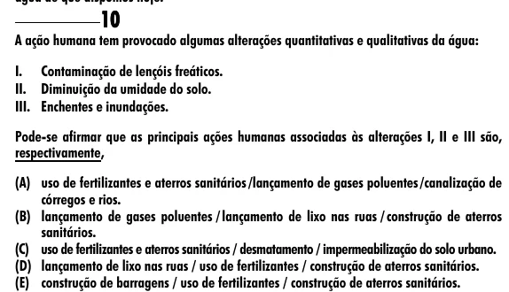

Texto extraído (pode conter ruído)

10  
A ação humana tem provocado algumas alterações quantitativas e qualitativas da água:  
I. Contaminação de lençóis freáticos.  
II. Diminuição da umidade do solo.  
III. Enchentes e inundações.  
Pode-se afirmar que as principais ações humanas associadas às alterações I, II e III são,  
respectivamente,  
(A) uso de fertilizantes e aterros sanitários / lançamento de gases poluentes / canalização de  
córregos e rios.  
(B) lançamento de gases poluentes / lançamento de lixo nas ruas / construção de aterros  
sanitários.  
(C) uso de fertilizantes e aterros sanitários / desmatamento / impermeabilização do solo urbano.  
(D) lançamento de lixo nas ruas / uso de fertilizantes / construção de aterros sanitários.  
(E) construção de barragens / uso de fertilizantes / construção de aterros sanitários.

