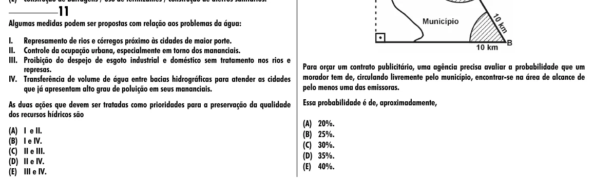

Texto extraído (pode conter ruído)

11  
Algumas medidas podem ser propostas com relação aos problemas da água:  
I. Represamento de rios e córregos próximo às cidades de maior porte.  
II. Controle da ocupação urbana, especialmente em torno dos mananciais.  
III. Proibição do despejo de esgoto industrial e doméstico sem tratamento nos rios e  
Para orçar um contrato publicitário, uma agência precisa avaliar a probabilidade que um  
represas.  
IV. Transferência de volume de água entre bacias hidrográficas para atender as cidades  
morador tem de, circulando livremente pelo município, encontrar-se na área de alcance de  
que já apresentam alto grau de poluição em seus mananciais.  
pelo menos uma das emissoras.  
As duas ações que devem ser tratadas como prioridades para a preservação da qualidade  
Essa probabilidade é de, aproximadamente,  
dos recursos hídricos são  
(A) 20%.  
(A) I e II.  
(B) 25%.  
(B) I e IV.  
(C) 30%.  
(C) II e III.  
(D) 35%.  
(D) II e IV.  
(E) 40%.  
(E) III e IV.

