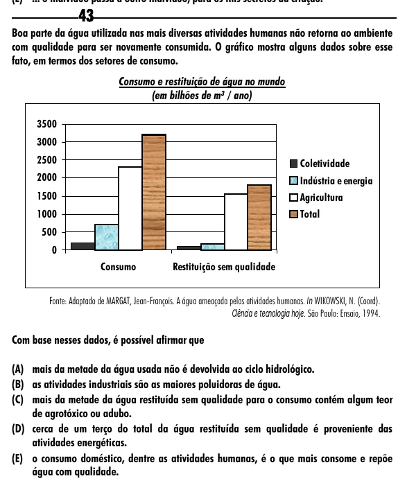

Texto extraído (pode conter ruído)

43  
Boa parte da água utilizada nas mais diversas atividades humanas não retorna ao ambiente  
com qualidade para ser novamente consumida. O gráfico mostra alguns dados sobre esse  
fato, em termos dos setores de consumo.  
Consumo e restituição de água no mundo  
(em bilhões de m³ / ano)  
3500  
3000  
2500  
Coletividade  
2000  
Indústria e energia  
1500  
Agricultura  
1000  
Total  
500  
0  
Consumo  
Restituição sem qualidade  
Fonte: Adaptado de MARGAT, Jean-François. A água ameaçada pelas atividades humanas. In WIKOWSKI, N. (Coord).  
Ciência e tecnologia hoje. São Paulo: Ensaio, 1994.  
Com base nesses dados, é possível afirmar que  
(A) mais da metade da água usada não é devolvida ao ciclo hidrológico.  
(B) as atividades industriais são as maiores poluidoras de água.  
(C) mais da metade da água restituída sem qualidade para o consumo contém algum teor  
de agrotóxico ou adubo.  
(D) cerca de um terço do total da água restituída sem qualidade é proveniente das  
atividades energéticas.  
(E) o consumo doméstico, dentre as atividades humanas, é o que mais consome e repõe  
água com qualidade.

