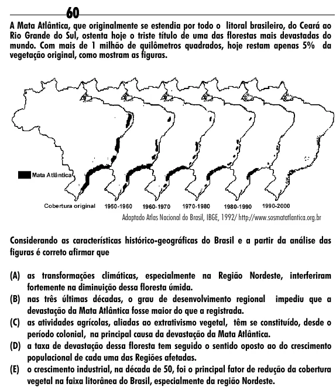

Texto extraído (pode conter ruído)

60  
A Mata Atlântica, que originalmente se estendia por todo o litoral brasileiro, do Ceará ao  
Rio Grande do Sul, ostenta hoje o triste título de uma das florestas mais devastadas do  
mundo. Com mais de 1 milhão de quilômetros quadrados, hoje restam apenas 5% da  
vegetação original, como mostram as figuras.  
Adaptado Atlas Nacional do Brasil, IBGE, 1992/ http://www.sosmatatlantica.org.br  
Considerando as características histórico-geográficas do Brasil e a partir da análise das  
figuras é correto afirmar que  
(A) as transformações climáticas, especialmente na Região Nordeste, interferiram  
fortemente na diminuição dessa floresta úmida.  
(B) nas três últimas décadas, o grau de desenvolvimento regional impediu que a  
devastação da Mata Atlântica fosse maior do que a registrada.  
(C) as atividades agrícolas, aliadas ao extrativismo vegetal, têm se constituído, desde o  
período colonial, na principal causa da devastação da Mata Atlântica.  
(D) a taxa de devastação dessa floresta tem seguido o sentido oposto ao do crescimento  
populacional de cada uma das Regiões afetadas.  
(E) o crescimento industrial, na década de 50, foi o principal fator de redução da cobertura  
vegetal na faixa litorânea do Brasil, especialmente da região Nordeste.

