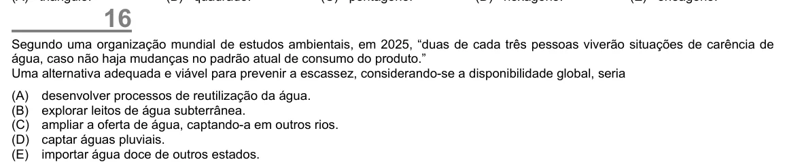

Texto extraído (pode conter ruído)

16  
Segundo uma organização mundial de estudos ambientais, em 2025, “duas de cada três pessoas viverão situações de carência de  
água, caso não haja mudanças no padrão atual de consumo do produto.”  
Uma alternativa adequada e viável para prevenir a escassez, considerando-se a disponibilidade global, seria  
(A)  
desenvolver processos de reutilização da água.  
(B)  
explorar leitos de água subterrânea.  
(C)  
ampliar a oferta de água, captando-a em outros rios.  
(D)  
captar águas pluviais.  
(E)  
importar água doce de outros estados.

