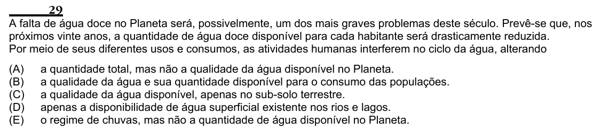

Texto extraído (pode conter ruído)

29  
A falta de água doce no Planeta será, possivelmente, um dos mais graves problemas deste século. Prevê-se que, nos  
próximos vinte anos, a quantidade de água doce disponível para cada habitante será drasticamente reduzida.  
Por meio de seus diferentes usos e consumos, as atividades humanas interferem no ciclo da água, alterando  
(A)  
a quantidade total, mas não a qualidade da água disponível no Planeta.  
(B)  
a qualidade da água e sua quantidade disponível para o consumo das populações.  
(C)  
a qualidade da água disponível, apenas no sub-solo terrestre.  
(D)  
apenas a disponibilidade de água superficial existente nos rios e lagos.  
(E)  
o regime de chuvas, mas não a quantidade de água disponível no Planeta.

