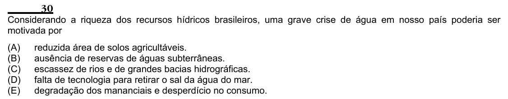

Texto extraído (pode conter ruído)

30  
Considerando a riqueza dos recursos hídricos brasileiros, uma grave crise de água em nosso país poderia ser  
motivada por  
(A)  
reduzida área de solos agricultáveis.  
(B)  
ausência de reservas de águas subterrâneas.  
(C)  
escassez de rios e de grandes bacias hidrográficas.  
(D)  
falta de tecnologia para retirar o sal da água do mar.  
(E)  
degradação dos mananciais e desperdício no consumo.

