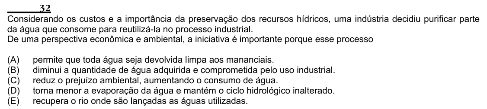

Texto extraído (pode conter ruído)

32  
Considerando os custos e a importância da preservação dos recursos hídricos, uma indústria decidiu purificar parte  
da água que consome para reutilizá-la no processo industrial.  
De uma perspectiva econômica e ambiental, a iniciativa é importante porque esse processo  
(A)  
permite que toda água seja devolvida limpa aos mananciais.  
(B)  
diminui a quantidade de água adquirida e comprometida pelo uso industrial.  
(C)  
reduz o prejuízo ambiental, aumentando o consumo de água.  
(D)  
torna menor a evaporação da água e mantém o ciclo hidrológico inalterado.  
(E)  
recupera o rio onde são lançadas as águas utilizadas.

