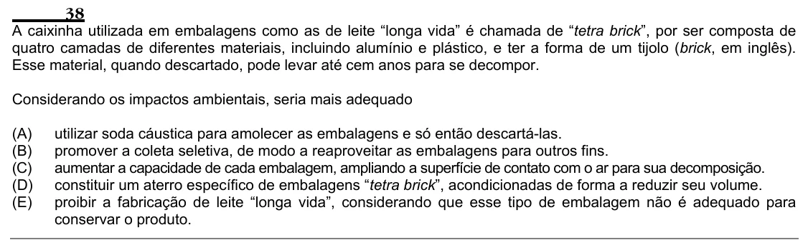

Texto extraído (pode conter ruído)

38  
A caixinha utilizada em embalagens como as de leite “longa vida” é chamada de “tetra brick”, por ser composta de  
quatro camadas de diferentes materiais, incluindo alumínio e plástico, e ter a forma de um tijolo (brick, em inglês).  
Esse material, quando descartado, pode levar até cem anos para se decompor.  
Considerando os impactos ambientais, seria mais adequado  
(A)  
utilizar soda cáustica para amolecer as embalagens e só então descartá-las.  
(B)  
promover a coleta seletiva, de modo a reaproveitar as embalagens para outros fins.  
(C)  
aumentar a capacidade de cada embalagem, ampliando a superfície de contato com o ar para sua decomposição.  
(D)  
constituir um aterro específico de embalagens “tetra brick”, acondicionadas de forma a reduzir seu volume.  
(E)  
proibir a fabricação de leite “longa vida”, considerando que esse tipo de embalagem não é adequado para  
conservar o produto.

