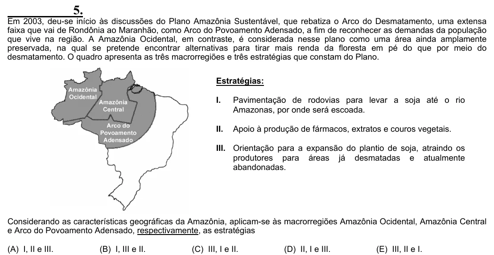

Texto extraído (pode conter ruído)

5.  
Em 2003, deu-se início às discussões do Plano Amazônia Sustentável, que rebatiza o Arco do Desmatamento, uma extensa  
faixa que vai de Rondônia ao Maranhão, como Arco do Povoamento Adensado, a fim de reconhecer as demandas da população  
que vive na região. A Amazônia Ocidental, em contraste, é considerada nesse plano como uma área ainda amplamente  
preservada, na qual se pretende encontrar alternativas para tirar mais renda da floresta em pé do que por meio do  
desmatamento. O quadro apresenta as três macrorregiões e três estratégias que constam do Plano.  
Estratégias:  
I.  
Pavimentação de rodovias para levar a soja até o rio  
Amazonas, por onde será escoada.  
II.  
Apoio à produção de fármacos, extratos e couros vegetais.  
III. Orientação para a expansão do plantio de soja, atraindo os  
produtores para áreas já desmatadas e atualmente  
abandonadas.  
Considerando as características geográficas da Amazônia, aplicam-se às macrorregiões Amazônia Ocidental, Amazônia Central  
e Arco do Povoamento Adensado, respectivamente, as estratégias  
(A) I, II e III.  
(B) I, III e II.  
(C) III, I e II.  
(D) II, I e III.  
(E) III, II e I.

