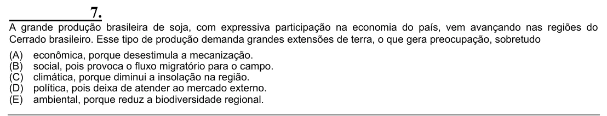

Texto extraído (pode conter ruído)

7.  
A grande produção brasileira de soja, com expressiva participação na economia do país, vem avançando nas regiões do  
Cerrado brasileiro. Esse tipo de produção demanda grandes extensões de terra, o que gera preocupação, sobretudo  
(A)  
econômica, porque desestimula a mecanização.  
(B)  
social, pois provoca o fluxo migratório para o campo.  
(C)  
climática, porque diminui a insolação na região.  
(D)  
política, pois deixa de atender ao mercado externo.  
(E)  
ambiental, porque reduz a biodiversidade regional.

