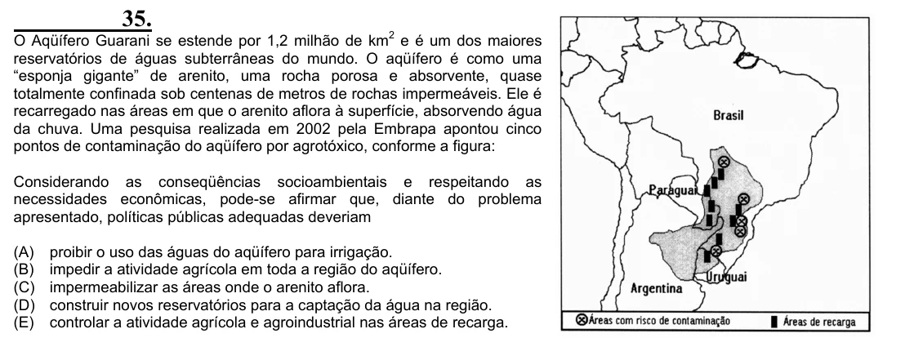

Texto extraído (pode conter ruído)

35.  
O Aqüífero Guarani se estende por 1,2 milhão de km 2 e é um dos maiores  
reservatórios de águas subterrâneas do mundo. O aqüífero é como uma  
“esponja gigante” de arenito, uma rocha porosa e absorvente, quase  
totalmente confinada sob centenas de metros de rochas impermeáveis. Ele é  
recarregado nas áreas em que o arenito aflora à superfície, absorvendo água  
da chuva. Uma pesquisa realizada em 2002 pela Embrapa apontou cinco  
pontos de contaminação do aqüífero por agrotóxico, conforme a figura:  
Considerando as conseqüências socioambientais e respeitando as  
necessidades econômicas, pode-se afirmar que, diante do problema  
apresentado, políticas públicas adequadas deveriam  
(A)  
proibir o uso das águas do aqüífero para irrigação.  
(B)  
impedir a atividade agrícola em toda a região do aqüífero.  
(C)  
impermeabilizar as áreas onde o arenito aflora.  
(D)  
construir novos reservatórios para a captação da água na região.  
(E)  
controlar a atividade agrícola e agroindustrial nas áreas de recarga.

