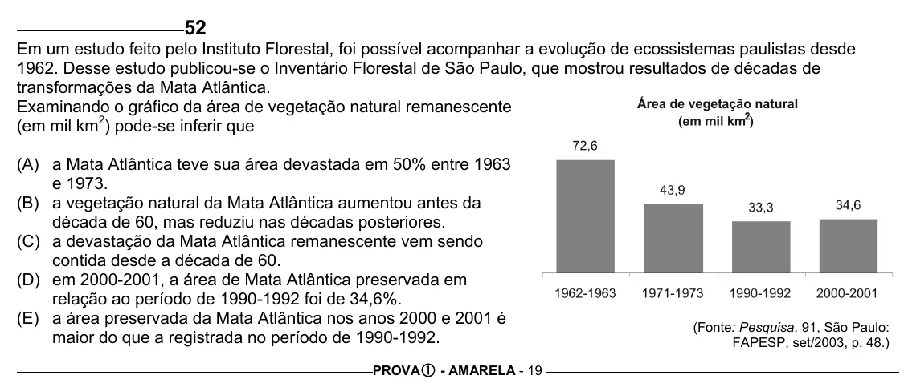

Texto extraído (pode conter ruído)

52  
Em um estudo feito pelo Instituto Florestal, foi possível acompanhar a evolução de ecossistemas paulistas desde  
1962. Desse estudo publicou-se o Inventário Florestal de São Paulo, que mostrou resultados de décadas de  
transformações da Mata Atlântica.  
Examinando o gráfico da área de vegetação natural remanescente  
(em mil km 2 ) pode-se inferir que  
(A) a Mata Atlântica teve sua área devastada em 50% entre 1963  
e 1973.  
(B) a vegetação natural da Mata Atlântica aumentou antes da  
década de 60, mas reduziu nas décadas posteriores.  
(C) a devastação da Mata Atlântica remanescente vem sendo  
contida desde a década de 60.  
(D) em 2000-2001, a área de Mata Atlântica preservada em  
relação ao período de 1990-1992 foi de 34,6%.  
(E) a área preservada da Mata Atlântica nos anos 2000 e 2001 é  
(Fonte: Pesquisa. 91, São Paulo:  
maior do que a registrada no período de 1990-1992.  
FAPESP, set/2003, p. 48.)  
PROVA c - AMARELA - 19

