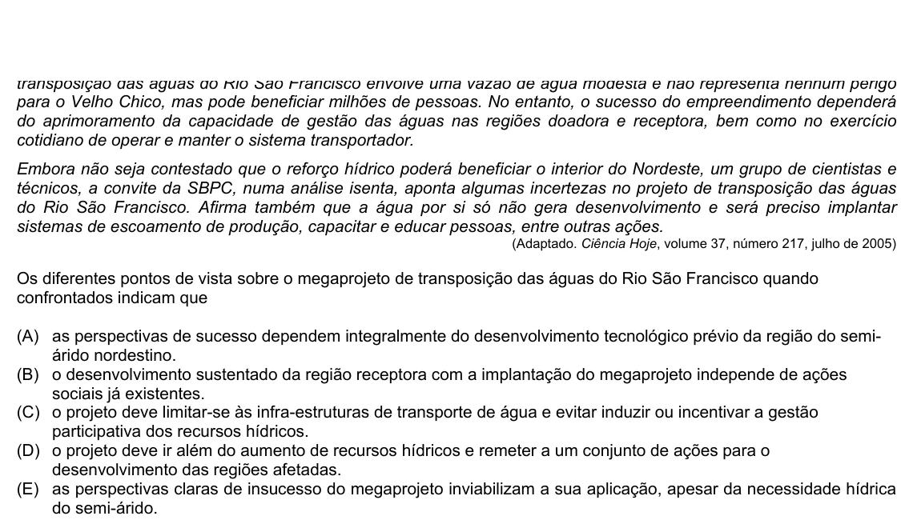

Texto extraído (pode conter ruído)

para o Velho Chico, mas pode beneficiar milhões de pessoas. No entanto, o sucesso do empreendimento dependerá  
do aprimoramento da capacidade de gestão das águas nas regiões doadora e receptora, bem como no exercício  
cotidiano de operar e manter o sistema transportador.  
Embora não seja contestado que o reforço hídrico poderá beneficiar o interior do Nordeste, um grupo de cientistas e  
técnicos, a convite da SBPC, numa análise isenta, aponta algumas incertezas no projeto de transposição das águas  
do Rio São Francisco. Afirma também que a água por si só não gera desenvolvimento e será preciso implantar  
sistemas de escoamento de produção, capacitar e educar pessoas, entre outras ações.  
(Adaptado. Ciência Hoje, volume 37, número 217, julho de 2005)  
Os diferentes pontos de vista sobre o megaprojeto de transposição das águas do Rio São Francisco quando  
confrontados indicam que  
(A) as perspectivas de sucesso dependem integralmente do desenvolvimento tecnológico prévio da região do semi-  
árido nordestino.  
(B) o desenvolvimento sustentado da região receptora com a implantação do megaprojeto independe de ações  
sociais já existentes.  
(C) o projeto deve limitar-se às infra-estruturas de transporte de água e evitar induzir ou incentivar a gestão  
participativa dos recursos hídricos.  
(D) o projeto deve ir além do aumento de recursos hídricos e remeter a um conjunto de ações para o  
desenvolvimento das regiões afetadas.  
(E) as perspectivas claras de insucesso do megaprojeto inviabilizam a sua aplicação, apesar da necessidade hídrica  
do semi-árido.

