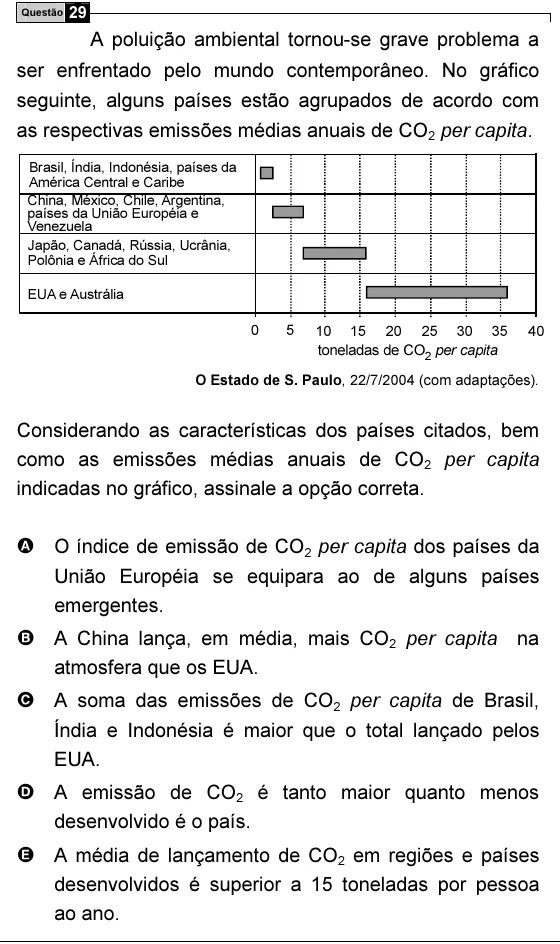

Texto extraído (pode conter ruído)

Questão 29  
A poluição ambiental tornou-se grave problema a  
ser enfrentado pelo mundo contemporâneo. No gráfico  
seguinte, alguns países estão agrupados de acordo com  
as respectivas emissões médias anuais de CO 2 per capita.  
Brasil, Índia, Indonésia, países da  
América Central e Caribe  
China, México, Chile, Argentina,  
países da União Européia e  
Venezuela  
Japão, Canadá, Rússia, Ucrânia,  
Polônia e África do Sul  
EUA e Austrália  
0  
5  
10 15 20 25 30 35  
40  
toneladas de CO 2 per capita  
O Estado de S. Paulo, 22/7/2004 (com adaptações).  
Considerando as características dos países citados, bem  
como as emissões médias anuais de CO 2 per capita  
indicadas no gráfico, assinale a opção correta.  
A O índice de emissão de CO 2 per capita dos países da  
União Européia se equipara ao de alguns países  
emergentes.  
B A China lança, em média, mais CO 2 per capita na  
atmosfera que os EUA.  
C A soma das emissões de CO 2 per capita de Brasil,  
Índia e Indonésia é maior que o total lançado pelos  
EUA.  
D A emissão de CO 2 é tanto maior quanto menos  
desenvolvido é o país.  
E A média de lançamento de CO 2 em regiões e países  
desenvolvidos é superior a 15 toneladas por pessoa  
ao ano.

