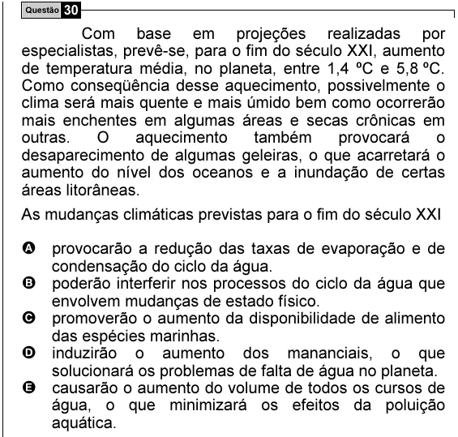

Texto extraído (pode conter ruído)

Questão 30  
Com base em projeções realizadas por  
especialistas, prevê-se, para o fim do século XXI, aumento  
de temperatura média, no planeta, entre 1,4 ºC e 5,8 ºC.  
Como conseqüência desse aquecimento, possivelmente o  
clima será mais quente e mais úmido bem como ocorrerão  
mais enchentes em algumas áreas e secas crônicas em  
outras.  
O  
aquecimento  
também  
provocará  
o  
desaparecimento de algumas geleiras, o que acarretará o  
aumento do nível dos oceanos e a inundação de certas  
áreas litorâneas.  
As mudanças climáticas previstas para o fim do século XXI  
A provocarão a redução das taxas de evaporação e de  
condensação do ciclo da água.  
B poderão interferir nos processos do ciclo da água que  
envolvem mudanças de estado físico.  
C promoverão o aumento da disponibilidade de alimento  
das espécies marinhas.  
D induzirão o aumento dos mananciais, o que  
solucionará os problemas de falta de água no planeta.  
E causarão o aumento do volume de todos os cursos de  
água, o que minimizará os efeitos da poluição  
aquática.

