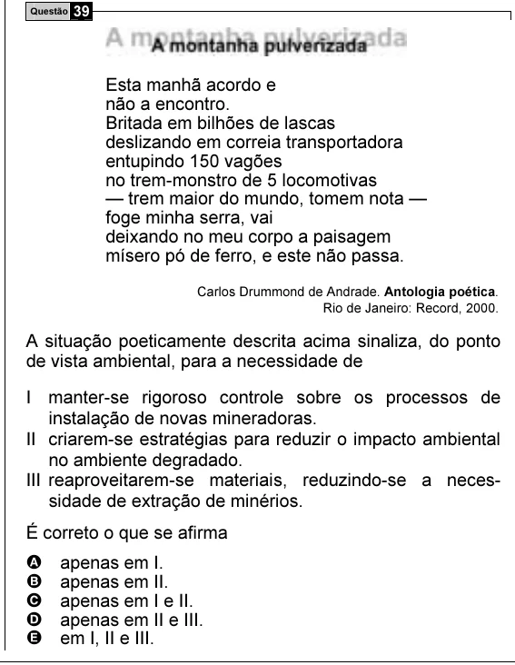

Texto extraído (pode conter ruído)

Questão 39  
Esta manhã acordo e  
não a encontro.  
Britada em bilhões de lascas  
deslizando em correia transportadora  
entupindo 150 vagões  
no trem-monstro de 5 locomotivas  
— trem maior do mundo, tomem nota —  
foge minha serra, vai  
deixando no meu corpo a paisagem  
mísero pó de ferro, e este não passa.  
Carlos Drummond de Andrade. Antologia poética.  
Rio de Janeiro: Record, 2000.  
A situação poeticamente descrita acima sinaliza, do ponto  
de vista ambiental, para a necessidade de  
I manter-se rigoroso controle sobre os processos de  
instalação de novas mineradoras.  
II criarem-se estratégias para reduzir o impacto ambiental  
no ambiente degradado.  
III reaproveitarem-se materiais, reduzindo-se a neces-  
sidade de extração de minérios.  
É correto o que se afirma  
A  
apenas em I.  
B  
apenas em II.  
C  
apenas em I e II.  
D  
apenas em II e III.  
E  
em I, II e III.

