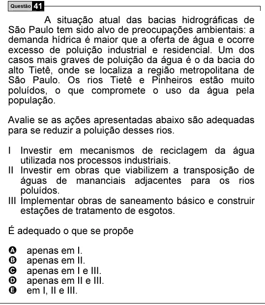

Texto extraído (pode conter ruído)

Questão 41  
A situação atual das bacias hidrográficas de  
São Paulo tem sido alvo de preocupações ambientais: a  
demanda hídrica é maior que a oferta de água e ocorre  
excesso de poluição industrial e residencial. Um dos  
casos mais graves de poluição da água é o da bacia do  
alto Tietê, onde se localiza a região metropolitana de  
São Paulo. Os rios Tietê e Pinheiros estão muito  
poluídos, o que compromete o uso da água pela  
população.  
Avalie se as ações apresentadas abaixo são adequadas  
para se reduzir a poluição desses rios.  
I Investir em mecanismos de reciclagem da água  
utilizada nos processos industriais.  
II Investir em obras que viabilizem a transposição de  
águas de mananciais adjacentes para os rios  
poluídos.  
III Implementar obras de saneamento básico e construir  
estações de tratamento de esgotos.  
É adequado o que se propõe  
A  
apenas em I.  
B  
apenas em II.  
C  
apenas em I e III.  
D  
apenas em II e III.  
E  
em I, II e III.

