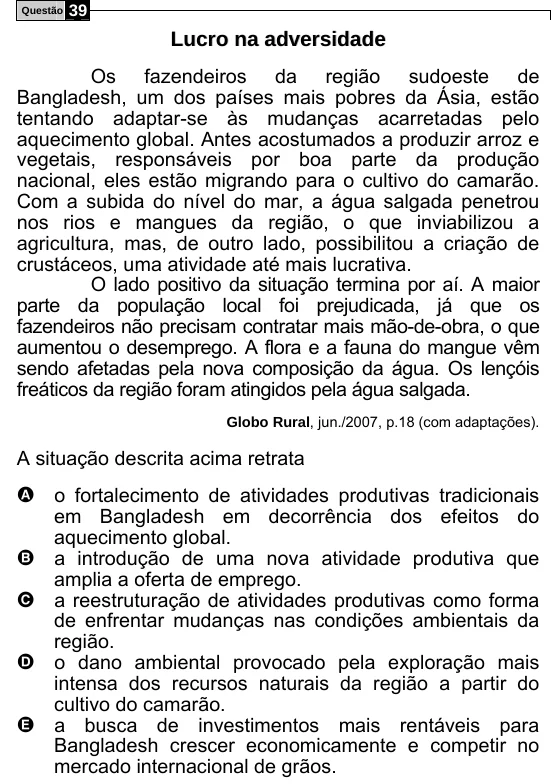

Texto extraído (pode conter ruído)

Questão  
39  
L u c r o n a a d v e r s i d a d e  
Os fazendeiros da região sudoeste de  
Bangladesh, um dos países mais pobres da Ásia, estão  
tentando adaptar-se às mudanças acarretadas pelo  
aquecimento global. Antes acostumados a produzir arroz e  
vegetais, responsáveis por boa parte da produção  
nacional, eles estão migrando para o cultivo do camarão.  
Com a subida do nível do mar, a água salgada penetrou  
nos rios e mangues da região, o que inviabilizou a  
agricultura, mas, de outro lado, possibilitou a criação de  
crustáceos, uma atividade até mais lucrativa.  
O lado positivo da situação termina por aí. A maior  
parte da população local foi prejudicada, já que os  
fazendeiros não precisam contratar mais mão-de-obra, o que  
aumentou o desemprego. A flora e a fauna do mangue vêm  
sendo afetadas pela nova composição da água. Os lençóis  
freáticos da região foram atingidos pela água salgada.  
Globo Rural, jun./2007, p.18 (com adaptações).  
A situação descrita acima retrata  
A o fortalecimento de atividades produtivas tradicionais  
em Bangladesh em decorrência dos efeitos do  
aquecimento global.  
a introdução de uma nova atividade produtiva que  
B  
amplia a oferta de emprego.  
a reestruturação de atividades produtivas como forma  
C  
de enfrentar mudanças nas condições ambientais da  
região.  
o dano ambiental provocado pela exploração mais  
D  
intensa dos recursos naturais da região a partir do  
cultivo do camarão.  
a busca de investimentos mais rentáveis para  
E  
Bangladesh crescer economicamente e competir no  
mercado internacional de grãos.

