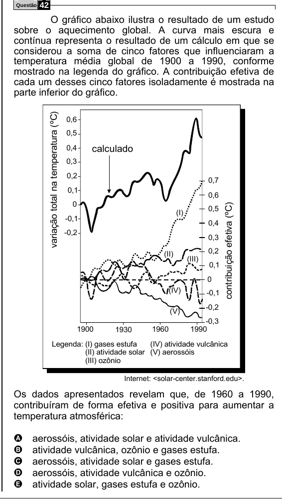

Texto extraído (pode conter ruído)

Questão  
42  
O gráfico abaixo ilustra o resultado de um estudo  
sobre o aquecimento global. A curva mais escura e  
contínua representa o resultado de um cálculo em que se  
considerou a soma de cinco fatores que influenciaram a  
temperatura média global de 1900 a 1990, conforme  
mostrado na legenda do gráfico. A contribuição efetiva de  
cada um desses cinco fatores isoladamente é mostrada na  
parte inferior do gráfico.  
variação total na temperatura (ºC)  
0,6  
0,5  
calculado  
0,4  
0,3  
0,2  
0,7  
0,1  
0,6  
0  
contribuição efetiva (ºC)  
0,5  
(I)  
-0,1  
0,4  
-0,2  
0,3  
0,2  
(II)  
(III)  
0,1  
0  
(IV)  
-0,1  
-0,2  
(V)  
-0,3  
1900  
1930  
1960  
1990  
Legenda: (I) gases estufa  
(IV) atividade vulcânica  
(II) atividade solar (V) aerossóis  
(III) ozônio  
Internet: <solar-center.stanford.edu>.  
Os dados apresentados revelam que, de 1960 a 1990,  
contribuíram de forma efetiva e positiva para aumentar a  
temperatura atmosférica:  
A  
aerossóis, atividade solar e atividade vulcânica.  
atividade vulcânica, ozônio e gases estufa.  
B  
C  
aerossóis, atividade solar e gases estufa.  
D  
aerossóis, atividade vulcânica e ozônio.  
atividade solar, gases estufa e ozônio.  
E

