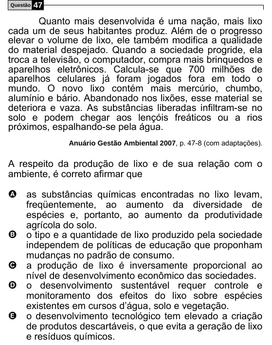

Texto extraído (pode conter ruído)

Questão  
47  
Quanto mais desenvolvida é uma nação, mais lixo  
cada um de seus habitantes produz. Além de o progresso  
elevar o volume de lixo, ele também modifica a qualidade  
do material despejado. Quando a sociedade progride, ela  
troca a televisão, o computador, compra mais brinquedos e  
aparelhos eletrônicos. Calcula-se que 700 milhões de  
aparelhos celulares já foram jogados fora em todo o  
mundo. O novo lixo contém mais mercúrio, chumbo,  
alumínio e bário. Abandonado nos lixões, esse material se  
deteriora e vaza. As substâncias liberadas infiltram-se no  
solo e podem chegar aos lençóis freáticos ou a rios  
próximos, espalhando-se pela água.  
Anuário Gestão Ambiental 2007, p. 47-8 (com adaptações).  
A respeito da produção de lixo e de sua relação com o  
ambiente, é correto afirmar que  
A as substâncias químicas encontradas no lixo levam,  
freqüentemente, ao aumento da diversidade de  
espécies e, portanto, ao aumento da produtividade  
agrícola do solo.  
o tipo e a quantidade de lixo produzido pela sociedade  
B  
independem de políticas de educação que proponham  
mudanças no padrão de consumo.  
a produção de lixo é inversamente proporcional ao  
C  
nível de desenvolvimento econômico das sociedades.  
D  
o desenvolvimento sustentável requer controle e  
monitoramento dos efeitos do lixo sobre espécies  
existentes em cursos d’água, solo e vegetação.  
E  
o desenvolvimento tecnológico tem elevado a criação  
de produtos descartáveis, o que evita a geração de lixo  
e resíduos químicos.

