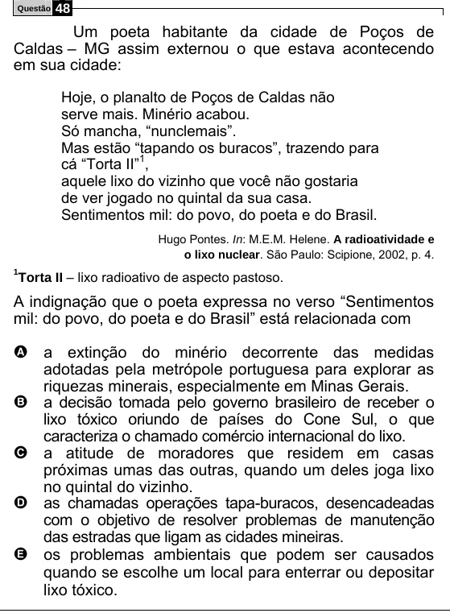

Texto extraído (pode conter ruído)

Questão  
48  
Um poeta habitante da cidade de Poços de  
Caldas – MG assim externou o que estava acontecendo  
em sua cidade:  
Hoje, o planalto de Poços de Caldas não  
serve mais. Minério acabou.  
Só mancha, “nunclemais”.  
Mas estão “tapando os buracos”, trazendo para  
cá “Torta II” 1 ,  
aquele lixo do vizinho que você não gostaria  
de ver jogado no quintal da sua casa.  
Sentimentos mil: do povo, do poeta e do Brasil.  
Hugo Pontes. In: M.E.M. Helene. A radioatividade e  
o lixo nuclear. São Paulo: Scipione, 2002, p. 4.  
1  
Torta II – lixo radioativo de aspecto pastoso.  
A indignação que o poeta expressa no verso “Sentimentos  
mil: do povo, do poeta e do Brasil” está relacionada com  
A a extinção do minério decorrente das medidas  
adotadas pela metrópole portuguesa para explorar as  
riquezas minerais, especialmente em Minas Gerais.  
B  
a decisão tomada pelo governo brasileiro de receber o  
lixo tóxico oriundo de países do Cone Sul, o que  
caracteriza o chamado comércio internacional do lixo.  
C  
a atitude de moradores que residem em casas  
próximas umas das outras, quando um deles joga lixo  
no quintal do vizinho.  
D  
as chamadas operações tapa-buracos, desencadeadas  
com o objetivo de resolver problemas de manutenção  
das estradas que ligam as cidades mineiras.  
E  
os problemas ambientais que podem ser causados  
quando se escolhe um local para enterrar ou depositar  
lixo tóxico.

