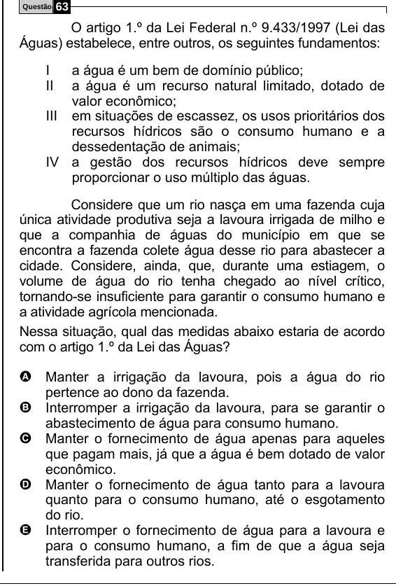

Texto extraído (pode conter ruído)

Questão  
63  
O artigo 1.º da Lei Federal n.º 9.433/1997 (Lei das  
Águas) estabelece, entre outros, os seguintes fundamentos:  
I  
a água é um bem de domínio público;  
II  
a água é um recurso natural limitado, dotado de  
valor econômico;  
III em situações de escassez, os usos prioritários dos  
recursos hídricos são o consumo humano e a  
dessedentação de animais;  
IV a gestão dos recursos hídricos deve sempre  
proporcionar o uso múltiplo das águas.  
Considere que um rio nasça em uma fazenda cuja  
única atividade produtiva seja a lavoura irrigada de milho e  
que a companhia de águas do município em que se  
encontra a fazenda colete água desse rio para abastecer a  
cidade. Considere, ainda, que, durante uma estiagem, o  
volume de água do rio tenha chegado ao nível crítico,  
tornando-se insuficiente para garantir o consumo humano e  
a atividade agrícola mencionada.  
Nessa situação, qual das medidas abaixo estaria de acordo  
com o artigo 1.º da Lei das Águas?  
A Manter a irrigação da lavoura, pois a água do rio  
pertence ao dono da fazenda.  
B Interromper a irrigação da lavoura, para se garantir o  
abastecimento de água para consumo humano.  
C Manter o fornecimento de água apenas para aqueles  
que pagam mais, já que a água é bem dotado de valor  
econômico.  
D Manter o fornecimento de água tanto para a lavoura  
quanto para o consumo humano, até o esgotamento  
do rio.  
E Interromper o fornecimento de água para a lavoura e  
para o consumo humano, a fim de que a água seja  
transferida para outros rios.

