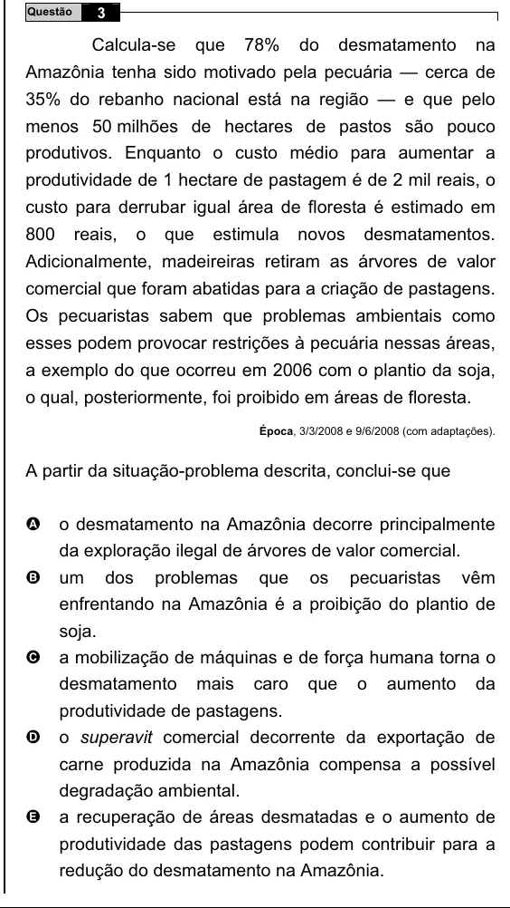

Texto extraído (pode conter ruído)

Questão  
3  
Calcula-se  
que  
78%  
do  
desmatamento  
na  
Amazônia tenha sido motivado pela pecuária — cerca de  
35% do rebanho nacional está na região — e que pelo  
menos 50 milhões de hectares de pastos são pouco  
produtivos. Enquanto o custo médio para aumentar a  
produtividade de 1 hectare de pastagem é de 2 mil reais, o  
custo para derrubar igual área de floresta é estimado em  
800  
reais,  
o  
que  
estimula  
novos  
desmatamentos.  
Adicionalmente, madeireiras retiram as árvores de valor  
comercial que foram abatidas para a criação de pastagens.  
Os pecuaristas sabem que problemas ambientais como  
esses podem provocar restrições à pecuária nessas áreas,  
a exemplo do que ocorreu em 2006 com o plantio da soja,  
o qual, posteriormente, foi proibido em áreas de floresta.  
Época, 3/3/2008 e 9/6/2008 (com adaptações).  
A partir da situação-problema descrita, conclui-se que  
A  
o desmatamento na Amazônia decorre principalmente  
da exploração ilegal de árvores de valor comercial.  
um dos problemas que os pecuaristas vêm  
B  
enfrentando na Amazônia é a proibição do plantio de  
soja.  
a mobilização de máquinas e de força humana torna o  
C  
desmatamento mais caro que o aumento da  
produtividade de pastagens.  
o superavit comercial decorrente da exportação de  
D  
carne produzida na Amazônia compensa a possível  
degradação ambiental.  
E  
a recuperação de áreas desmatadas e o aumento de  
produtividade das pastagens podem contribuir para a  
redução do desmatamento na Amazônia.

