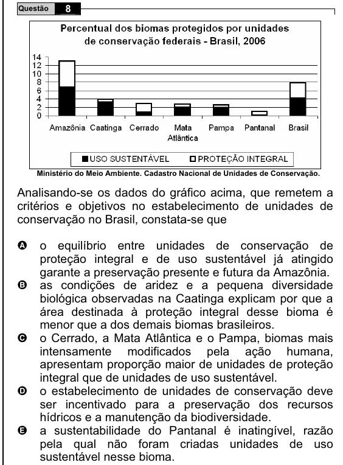

Texto extraído (pode conter ruído)

8  
Questão  
Ministério do Meio Ambiente. Cadastro Nacional de Unidades de Conservação.  
Analisando-se os dados do gráfico acima, que remetem a  
critérios e objetivos no estabelecimento de unidades de  
conservação no Brasil, constata-se que  
o equilíbrio entre unidades de conservação de  
A  
proteção integral e de uso sustentável já atingido  
garante a preservação presente e futura da Amazônia.  
B  
as condições de aridez e a pequena diversidade  
biológica observadas na Caatinga explicam por que a  
área destinada à proteção integral desse bioma é  
menor que a dos demais biomas brasileiros.  
C  
o Cerrado, a Mata Atlântica e o Pampa, biomas mais  
intensamente modificados pela ação humana,  
apresentam proporção maior de unidades de proteção  
integral que de unidades de uso sustentável.  
D  
o estabelecimento de unidades de conservação deve  
ser incentivado para a preservação dos recursos  
hídricos e a manutenção da biodiversidade.  
E  
a sustentabilidade do Pantanal é inatingível, razão  
pela qual não foram criadas unidades de uso  
sustentável nesse bioma.

