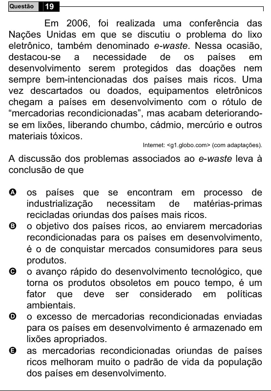

Texto extraído (pode conter ruído)

Questão  
19  
Em 2006, foi realizada uma conferência das  
Nações Unidas em que se discutiu o problema do lixo  
eletrônico, também denominado e-waste. Nessa ocasião,  
destacou-se a necessidade de os países em  
desenvolvimento serem protegidos das doações nem  
sempre bem-intencionadas dos países mais ricos. Uma  
vez descartados ou doados, equipamentos eletrônicos  
chegam a países em desenvolvimento com o rótulo de  
“mercadorias recondicionadas”, mas acabam deteriorando-  
se em lixões, liberando chumbo, cádmio, mercúrio e outros  
materiais tóxicos.  
Internet: <g1.globo.com> (com adaptações).  
A discussão dos problemas associados ao e-waste leva à  
conclusão de que  
A  
os países que se encontram em processo de  
industrialização necessitam de matérias-primas  
recicladas oriundas dos países mais ricos.  
B  
o objetivo dos países ricos, ao enviarem mercadorias  
recondicionadas para os países em desenvolvimento,  
é o de conquistar mercados consumidores para seus  
produtos.  
o avanço rápido do desenvolvimento tecnológico, que  
C  
torna os produtos obsoletos em pouco tempo, é um  
fator que deve ser considerado em políticas  
ambientais.  
o excesso de mercadorias recondicionadas enviadas  
D  
para os países em desenvolvimento é armazenado em  
lixões apropriados.  
as mercadorias recondicionadas oriundas de países  
E  
ricos melhoram muito o padrão de vida da população  
dos países em desenvolvimento.

