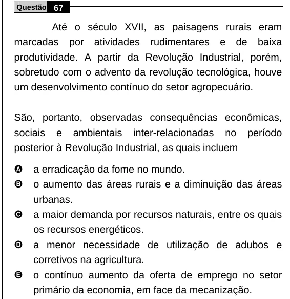

Texto extraído (pode conter ruído)

Questão 67  
Até o século XVII, as paisagens rurais eram  
marcadas por atividades rudimentares e de baixa  
produtividade. A partir da Revolução Industrial, porém,  
sobretudo com o advento da revolução tecnológica, houve  
um desenvolvimento contínuo do setor agropecuário.  
São, portanto, observadas consequências econômicas,  
sociais e ambientais inter-relacionadas no período  
posterior à Revolução Industrial, as quais incluem  
A  
a erradicação da fome no mundo.  
B  
o aumento das áreas rurais e a diminuição das áreas  
urbanas.  
C  
a maior demanda por recursos naturais, entre os quais  
os recursos energéticos.  
D  
a menor necessidade de utilização de adubos e  
corretivos na agricultura.  
E  
o contínuo aumento da oferta de emprego no setor  
primário da economia, em face da mecanização.

