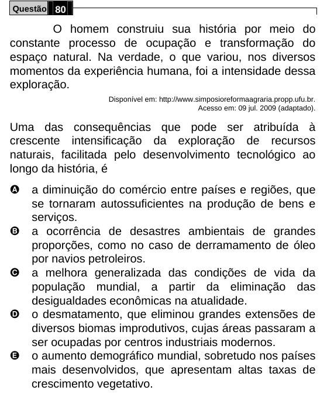

Texto extraído (pode conter ruído)

Questão 80  
O homem construiu sua história por meio do  
constante processo de ocupação e transformação do  
espaço natural. Na verdade, o que variou, nos diversos  
momentos da experiência humana, foi a intensidade dessa  
exploração.  
Disponível em: http://www.simposioreformaagraria.propp.ufu.br.  
Acesso em: 09 jul. 2009 (adaptado).  
Uma das consequências que pode ser atribuída à  
crescente intensificação da exploração de recursos  
naturais, facilitada pelo desenvolvimento tecnológico ao  
longo da história, é  
A  
a diminuição do comércio entre países e regiões, que  
se tornaram autossuficientes na produção de bens e  
serviços.  
B  
a ocorrência de desastres ambientais de grandes  
proporções, como no caso de derramamento de óleo  
por navios petroleiros.  
C  
a melhora generalizada das condições de vida da  
população mundial, a partir da eliminação das  
desigualdades econômicas na atualidade.  
D  
o desmatamento, que eliminou grandes extensões de  
diversos biomas improdutivos, cujas áreas passaram a  
ser ocupadas por centros industriais modernos.  
E  
o aumento demográfico mundial, sobretudo nos países  
mais desenvolvidos, que apresentam altas taxas de  
crescimento vegetativo.

