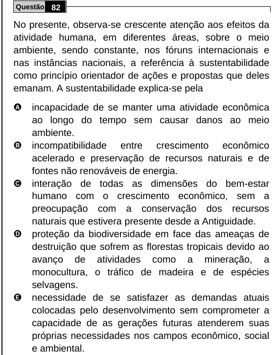

Texto extraído (pode conter ruído)

Questão 82  
No presente, observa-se crescente atenção aos efeitos da  
atividade humana, em diferentes áreas, sobre o meio  
ambiente, sendo constante, nos fóruns internacionais e  
nas instâncias nacionais, a referência à sustentabilidade  
como princípio orientador de ações e propostas que deles  
emanam. A sustentabilidade explica-se pela  
A  
incapacidade de se manter uma atividade econômica  
ao longo do tempo sem causar danos ao meio  
ambiente.  
B  
incompatibilidade entre crescimento econômico  
acelerado e preservação de recursos naturais e de  
fontes não renováveis de energia.  
C  
interação de todas as dimensões do bem-estar  
humano com o crescimento econômico, sem a  
preocupação com a conservação dos recursos  
naturais que estivera presente desde a Antiguidade.  
D  
proteção da biodiversidade em face das ameaças de  
destruição que sofrem as florestas tropicais devido ao  
avanço de atividades como a mineração, a  
monocultura, o tráfico de madeira e de espécies  
selvagens.  
E  
necessidade de se satisfazer as demandas atuais  
colocadas pelo desenvolvimento sem comprometer a  
capacidade de as gerações futuras atenderem suas  
próprias necessidades nos campos econômico, social  
e ambiental.

