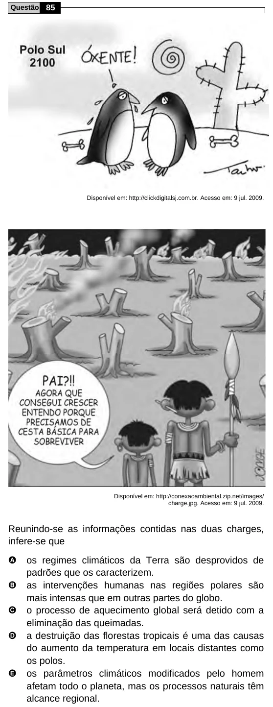

Texto extraído (pode conter ruído)

Questão 85  
Disponível em: http://clickdigitalsj.com.br. Acesso em: 9 jul. 2009.  
Disponível em: http://conexaoambiental.zip.net/images/  
charge.jpg. Acesso em: 9 jul. 2009.  
Reunindo-se as informações contidas nas duas charges,  
infere-se que  
A  
os regimes climáticos da Terra são desprovidos de  
padrões que os caracterizem.  
B  
as intervenções humanas nas regiões polares são  
mais intensas que em outras partes do globo.  
C  
o processo de aquecimento global será detido com a  
eliminação das queimadas.  
D  
a destruição das florestas tropicais é uma das causas  
do aumento da temperatura em locais distantes como  
os polos.  
E  
os parâmetros climáticos modificados pelo homem  
afetam todo o planeta, mas os processos naturais têm  
alcance regional.

