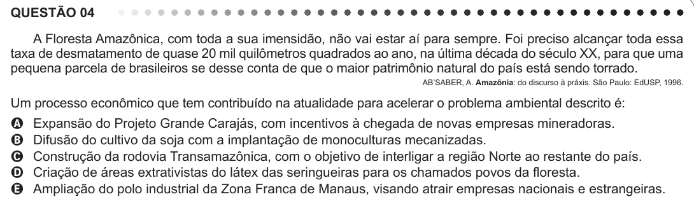

Texto extraído (pode conter ruído)

QUESTÃO 04  
A Floresta Amazônica, com toda a sua imensidão, não vai estar aí para sempre. Foi preciso alcançar toda essa  
taxa de desmatamento de quase 20 mil quilômetros quadrados ao ano, na última década do século XX, para que uma  
pequena parcela de brasileiros se desse conta de que o maior patrimônio natural do país está sendo torrado.  
AB’SABER, A. Amazônia: do discurso à práxis. São Paulo: EdUSP, 1996.  
Um processo econômico que tem contribuído na atualidade para acelerar o problema ambiental descrito é:  
Expansão do Projeto Grande Carajás, com incentivos à chegada de novas empresas mineradoras.  
A  
Difusão do cultivo da soja com a implantação de monoculturas mecanizadas.  
B  
Construção da rodovia Transamazônica, com o objetivo de interligar a região Norte ao restante do país.  
C  
Criação de áreas extrativistas do látex das seringueiras para os chamados povos da floresta.  
D  
Ampliação do polo industrial da Zona Franca de Manaus, visando atrair empresas nacionais e estrangeiras.  
E

