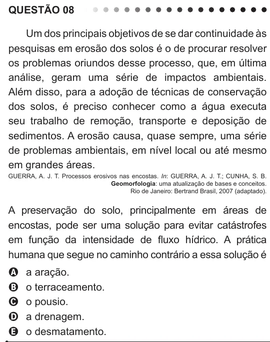

Texto extraído (pode conter ruído)

QUESTÃO 08  
Um dos principais objetivos de se dar continuidade às  
pesquisas em erosão dos solos é o de procurar resolver  
os problemas oriundos desse processo, que, em última  
análise, geram uma série de impactos ambientais.  
Além disso, para a adoção de técnicas de conservação  
dos solos, é preciso conhecer como a água executa  
seu trabalho de remoção, transporte e deposição de  
sedimentos. A erosão causa, quase sempre, uma série  
de problemas ambientais, em nível local ou até mesmo  
em grandes áreas.  
GUERRA, A. J. T. Processos erosivos nas encostas. In: GUERRA, A. J. T.; CUNHA, S. B.  
Geomorfologia: uma atualização de bases e conceitos.  
Rio de Janeiro: Bertrand Brasil, 2007 (adaptado).  
A preservação do solo, principalmente em áreas de  
encostas, pode ser uma solução para evitar catástrofes  
em função da intensidade de fluxo hídrico. A prática  
humana que segue no caminho contrário a essa solução é  
a aração.  
A  
B  
o terraceamento.  
C  
o pousio.  
a drenagem.  
D  
o desmatamento.  
E

