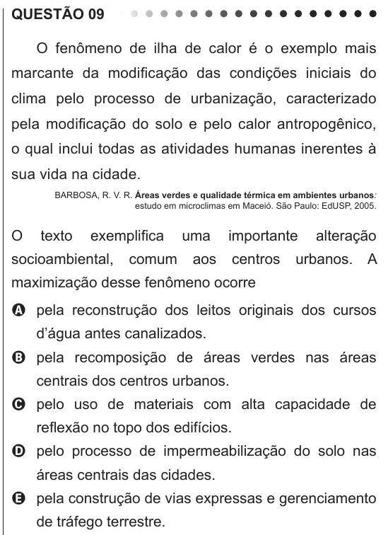

Texto extraído (pode conter ruído)

QUESTÃO 09  
O fenômeno de ilha de calor é o exemplo mais  
marcante da modificação das condições iniciais do  
clima pelo processo de urbanização, caracterizado  
pela modificação do solo e pelo calor antropogênico,  
o qual inclui todas as atividades humanas inerentes à  
sua vida na cidade.  
BARBOSA, R. V. R. Áreas verdes e qualidade térmica em ambientes urbanos:  
estudo em microclimas em Maceió. São Paulo: EdUSP, 2005.  
O  
texto  
exemplifica  
uma  
importante  
alteração  
socioambiental,  
comum  
aos  
centros  
urbanos. A  
maximização desse fenômeno ocorre  
A pela reconstrução dos leitos originais dos cursos  
d’água antes canalizados.  
B pela recomposição de áreas verdes nas áreas  
centrais dos centros urbanos.  
C pelo uso de materiais com alta capacidade de  
reflexão no topo dos edifícios.  
D pelo processo de impermeabilização do solo nas  
áreas centrais das cidades.  
E pela construção de vias expressas e gerenciamento  
de tráfego terrestre.

