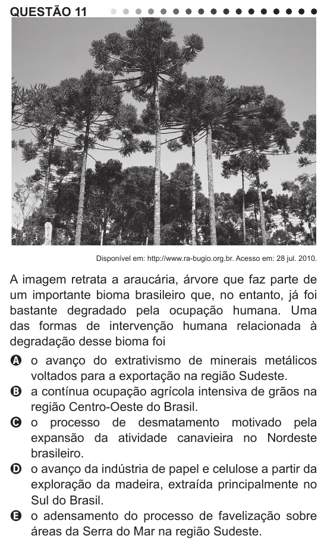

Texto extraído (pode conter ruído)

QUESTÃO 11  
Disponível em: http://www.ra-bugio.org.br. Acesso em: 28 jul. 2010.  
A imagem retrata a araucária, árvore que faz parte de  
um importante bioma brasileiro que, no entanto, já foi  
bastante degradado pela ocupação humana. Uma  
das formas de intervenção humana relacionada à  
degradação desse bioma foi  
A o avanço do extrativismo de minerais metálicos  
voltados para a exportação na região Sudeste.  
B a contínua ocupação agrícola intensiva de grãos na  
região Centro-Oeste do Brasil.  
C o processo de desmatamento motivado pela  
expansão da atividade canavieira no Nordeste  
brasileiro.  
D o avanço da indústria de papel e celulose a partir da  
exploração da madeira, extraída principalmente no  
Sul do Brasil.  
E o adensamento do processo de favelização sobre  
áreas da Serra do Mar na região Sudeste.

