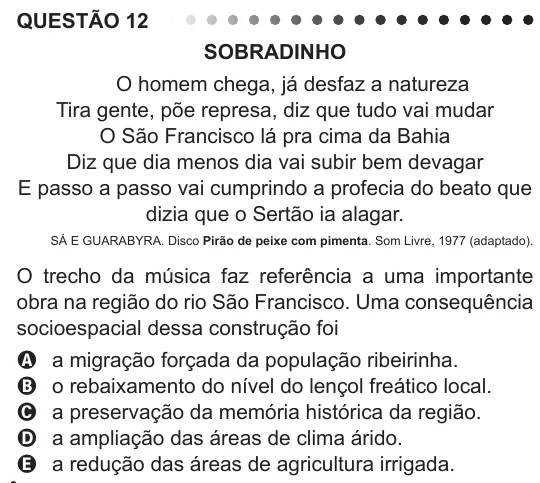

Texto extraído (pode conter ruído)

QUESTÃO 12  
SOBRADINHO  
O homem chega, já desfaz a natureza  
Tira gente, põe represa, diz que tudo vai mudar  
O São Francisco lá pra cima da Bahia  
Diz que dia menos dia vai subir bem devagar  
E passo a passo vai cumprindo a profecia do beato que  
dizia que o Sertão ia alagar.  
Sá e Guarabyra. Disco Pirão de peixe com pimenta. Som Livre, 1977 (adaptado).  
O trecho da música faz referência a uma importante  
obra na região do rio São Francisco. Uma consequência  
socioespacial dessa construção foi  
A  
a migração forçada da população ribeirinha.  
B  
o rebaixamento do nível do lençol freático local.  
a preservação da memória histórica da região.  
C  
a ampliação das áreas de clima árido.  
D  
a redução das áreas de agricultura irrigada.  
E

